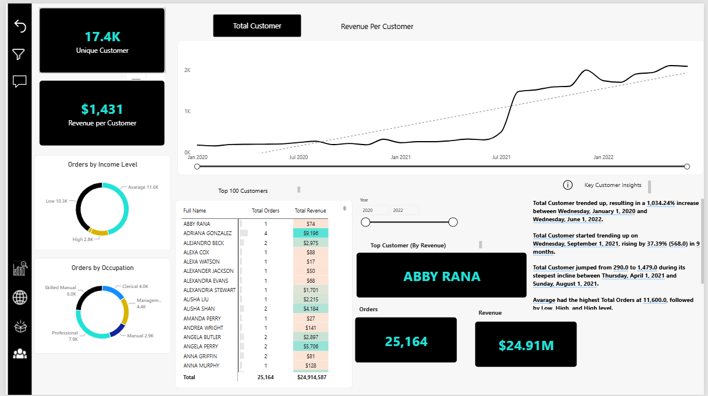
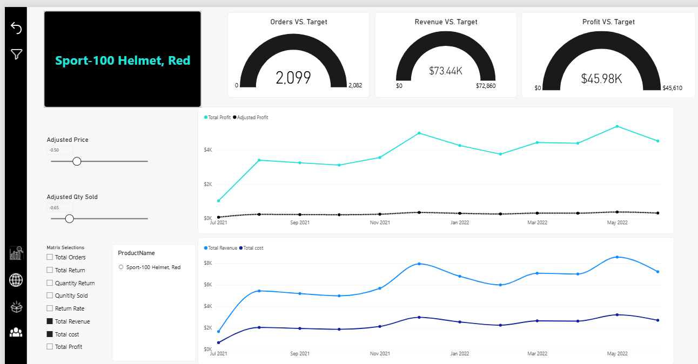

 AdventureWorks Sales Analysis | Power BI

 📌 Project Overview

An interactive Power BI dashboard designed to analyze AdventureWorks business performance, focusing on sales, profitability, customer behavior, and product performance.

 📊 Dashboard Pages

1. Overview Dashboard
- Total Revenue, Profit, Orders, and Return Rate.
- Revenue Trends.
- Orders by Category.
- Top 10 Products.
- Monthly Performance Analysis.

2. Customer Analysis
- Unique Customers.
- Revenue per Customer.
- Customer Segmentation.
- Top 100 Customers.
- Top Customer by Revenue.

 3. Product Analysis
- Product Performance.
- Orders vs. Target.
- Revenue vs. Target.
- Profit vs. Target.
- What-if Analysis using Adjusted Price and Adjusted Quantity Sold.

 🛠️ Tools & Skills
- Microsoft Power BI
- DAX
- Data Modeling
- Data Visualization
- Interactive Dashboards
- What-if Parameters

 📷 Dashboard Preview

 1. Overview Dashboard

 2. Customer Analysis

 3. Product Analysis

 📁 Project Files

The repository includes:
- Power BI `.pbix` file.
- Dashboard screenshots.

 👨‍💻 Author

  Mohamed Reda

Aspiring Data Analyst
